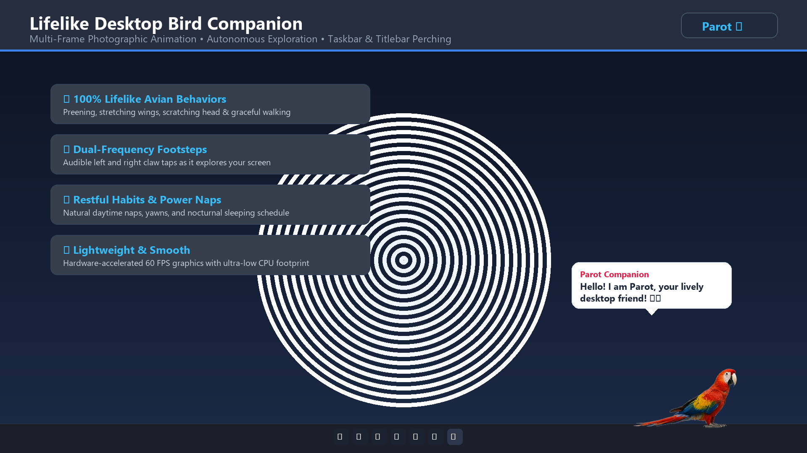
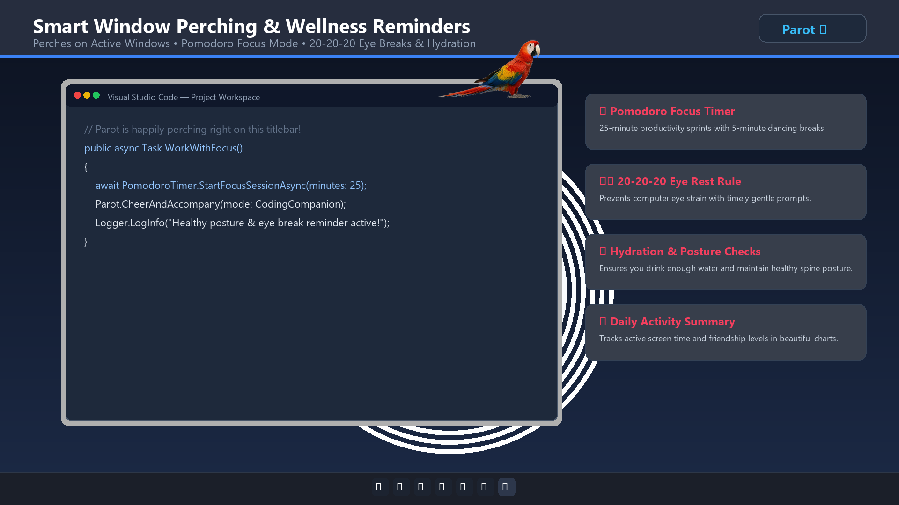
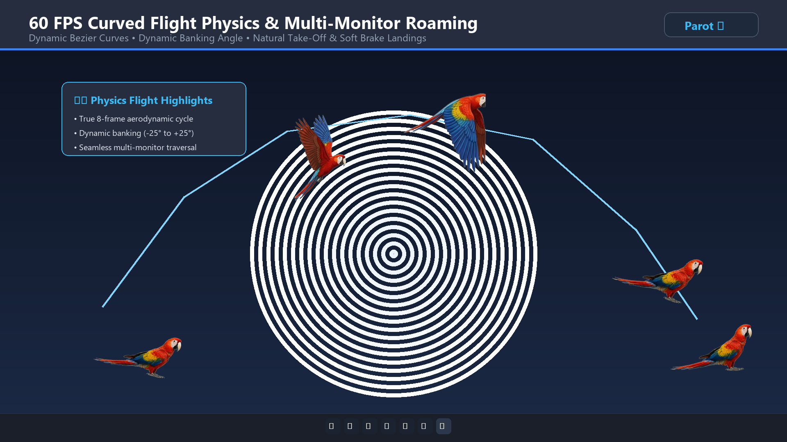
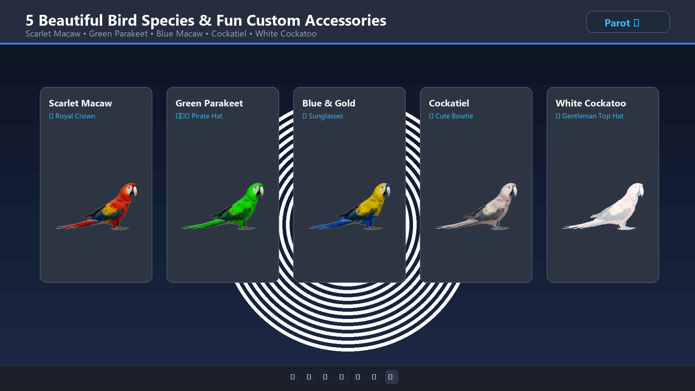
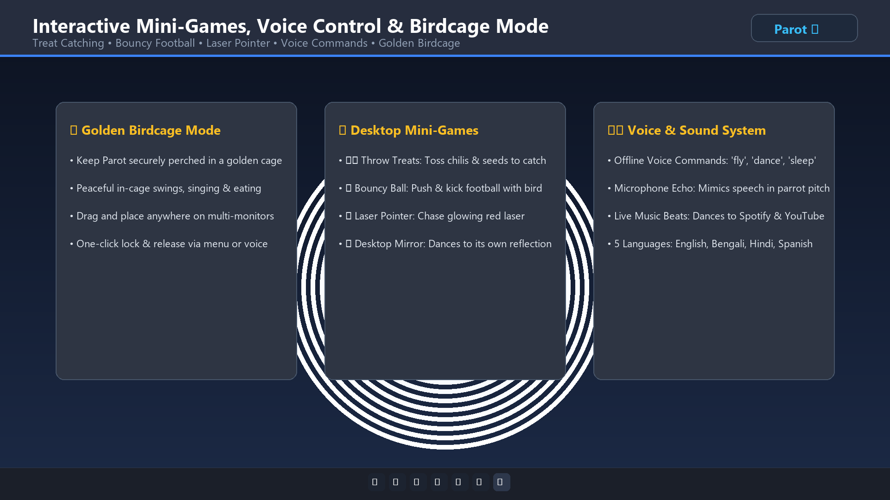

<div align="center">

# 🦜 Parot
### The Ultimate Lifelike Desktop Bird Companion for Windows

[](https://apps.microsoft.com/detail/9NDQ2S4Q0RJT)
[](https://dotnet.microsoft.com/)
[](#-testing--verification)
[](LICENSE)
[](https://apps.microsoft.com/detail/9NDQ2S4Q0RJT)

<p align="center">
  <b>A production-grade, hyper-realistic, multi-frame animated avian companion for your Windows desktop.</b><br>
  <i>Parot walks with audible claw taps, hops, stretches wings, preens feathers, scratches its head, perches on application titlebars, takes naps, mimics speech, and guards your wellness with integrated Pomodoro & 20-20-20 eye strain breaks!</i>
</p>

[**Microsoft Store Listing**](https://apps.microsoft.com/detail/9NDQ2S4Q0RJT) • [**Key Features**](#-key-features) • [**Screenshots**](#-screenshots) • [**Voice Commands**](#-voice-commands--audio-engine) • [**Controls**](#-controls--shortcuts) • [**Build & Package**](#-build--msix-packaging)

---

</div>

## 📸 Screenshots

<div align="center">

### 🖥️ Desktop Companion & Smart Taskbar Perching


### 🪟 Active Window Perching & Pomodoro Focus Timer


### ✈️ 60 FPS Curved Bezier Flight Across Multi-Monitors


### 🦜 5 Beautiful Species & 7 Custom Accessories


### 🎮 Mini-Games, Voice Recognition & Golden Birdcage


</div>

---

## 🌟 Key Features

### 🪶 1. 100% Autonomous Lifelike Avian Behaviors
Parot is powered by a **Unified Autonomous Living Avian Decision Engine** that drives natural bird instincts every 6–12 seconds:
- **Audible Claw Footsteps:** Dual-frequency claw tapping sounds (`620Hz` and `530Hz`) create authentic left/right pitter-patter footsteps along your taskbar and window edges.
- **Natural Parabolic Hopping:** Physics-based jumping with landing squash and playful chirps.
- **Avian Grooming & Body Care:** 
  - 🪶 **Preening:** Smooths feathers with delicate beak movements.
  - 🦅 **Wing Stretch:** Extends individual wings to stretch out stiffness.
  - 💨 **Feather Fluffing:** Ruffles plumage with natural feather rustle particles.
  - 🌿 **Beak Wiping:** Cleans beak against surfaces left and right.
  - 🦶 **Head Scratching:** Tilts neck and scratches behind ears with its foot.
  - 🐕 **Tail Wagging:** Shakes tail feathers in happiness and balance.
  - 🥱 **Yawning:** Yawns sweetly before and after naps.
- **Restful Habits & Power Naps:** Takes short daytime power naps with gentle breathing and follows an automatic nocturnal sleep schedule (`NightSleeping`).
- **Insect Hunting & Foraging:** Forages on your desktop and pounces on **Ladybugs (🐞)** and **Grasshoppers (🦗)** with realistic pecking and crumb particles.

### 🪟 2. Smart Multi-Monitor Window Perching
- **Active Window Detection:** Automatically detects open application windows (VS Code, Chrome, Edge, File Explorer, Terminal) and perches right on their titlebars.
- **DWM Cloaked Protection:** Employs Windows DWM `DWMWA_CLOAKED` detection to prevent perching on invisible or minimized background UWP apps. Parot will **never float in empty air** when your desktop has no open tabs.
- **Window Drag Tracking:** Follows the window smoothly if you drag or move it across your screen.
- **Startled Take-Off:** If a window is minimized or closed, Parot performs an alarmed startle (`Startled!`) and lands safely on your taskbar.
- **Multi-Monitor Drag & Place:** Drag Parot onto secondary and tertiary monitors (`GetMonitorWorkAreaFromPoint`); it stays securely anchored where you put it.

### ✈️ 3. 60 FPS Curved Flight Physics
- **Quadratic Bezier Flight Curves:** Glides in smooth, natural arcs rather than robotic straight lines.
- **Dynamic Banking Angles:** Tilts wings realistically (-25° to +25°) along flight tangents.
- **Full 8-Frame Aerodynamic Cycle:** Complete wing-up, downstroke, glide, and soft brake landing animations at 12 FPS sprite cycles rendered over a 60 FPS hardware loop.

### 🏰 4. Golden Birdcage Mode
- Need Parot to stay quietly in a designated spot? Put it in its **Golden Birdcage**!
- In cage mode, Parot perches on a golden swing, sings, eats seeds, and performs peaceful in-cage idle behaviors without flying away.
- Toggle anytime via Right-Click menu, Settings, or voice command (*"cage"* / *"birdcage"*).

### 🍅 5. Pomodoro Focus & Screen-Time Wellness Guardian
- **🍅 Pomodoro Timer:** 25-minute productivity focus sprints with 5-minute dancing breaks.
- **👁️ 20-20-20 Rule:** Timely reminders to look 20 feet away for 20 seconds to prevent computer eye strain.
- **💧 Hydration Check:** Encourages you to stay hydrated during work.
- **🧘 Posture Check:** Reminds you to correct spine posture and stretch.
- **📊 Daily Report Window:** Tracks active screen time, completed Pomodoros, and bird friendship level in clear graphs.

### 🦜 6. 5 Bird Species & 7 Fun Accessories
- **5 Handcrafted Species:**
  1. 🔴 **Scarlet Macaw** *(Default vibrant red-yellow-blue)*
  2. 🟢 **Green Parakeet** *(Classic emerald parakeet)*
  3. 🔵 **Blue & Gold Macaw** *(Majestic royal blue and gold)*
  4. 🟡 **Cockatiel** *(Yellow crest and orange cheeks)*
  5. ⚪ **White Cockatoo** *(Snow-white cockatoo)*
- **7 Wearable Accessories:**
  - 🏴‍☠️ Pirate Hat • 👑 Royal Crown • 😎 Sunglasses • 🎀 Cute Bowtie • 🎩 Top Hat • 🎧 Headphones • None
- **🦜🦜 Companion Bird Buddy:** Summon a second companion bird (`CompanionWindow`) to fly and play tag alongside your main bird!

### 🎮 7. Interactive Mini-Games
1. **🌶️ Toss Treats:** Throw chilis, peanuts, or sunflower seeds (`TreatItemWindow`) for Parot to catch mid-air.
2. **⚽ Football Push Game:** Push and kick a bouncy desktop ball (`BouncyBallWindow`) back and forth with Parot.
3. **🔴 Laser Pointer Chase:** Move a glowing red laser dot (`LaserPointerWindow`) for Parot to eagerly chase.
4. **🪞 Desktop Mirror:** Bring out an interactive mirror (`DesktopMirrorWindow`) to see Parot fluff its feathers and dance.
5. **🏃 Play Tag:** Play a game of chase with your mouse cursor.
6. **👆 Perch on Cursor:** Have Parot hop onto your mouse pointer and travel with you.
7. **😵 Dizzy Spin:** Rapidly circle your cursor around Parot to make it hilariously dizzy with cartoon stars.

### 🎙️ 8. Voice Commands & Audio Engine
- **🗣️ Offline Voice Recognition:** Speaks directly to your microphone without sending audio to the cloud:
  - `"fly"` / `"take off"` — Takes to the sky.
  - `"come here"` / `"perch"` — Flies to your mouse cursor.
  - `"sleep"` / `"good night"` — Puts Parot to sleep.
  - `"wake up"` — Wakes Parot up refreshed.
  - `"eat"` / `"feed"` — Forages for a snack.
  - `"dance"` / `"party"` — Dances to celebratory music.
  - `"cage"` / `"lock"` — Toggles birdcage mode.
- **🎙️ Microphone Pitch Echo:** Listens to your voice and echoes your words back in authentic high-pitched parrot speech!
- **🎵 Live Music Beat Sync:** Detects system audio beats (Spotify, YouTube, VLC) and bobs its head to the rhythm.
- **Master Mute:** Single-click middle mouse button or taskbar tray to silence all sounds instantly.

### 💻 9. OS & Hardware Awareness
- **⚡ Charger Plug/Unplug Alerts:** Reacts when laptop charger is connected or disconnected.
- **🪫 Low Battery Warnings:** Warns when battery drops below 20%.
- **📋 Clipboard Preview:** Previews text copied to clipboard with curious head tilts.
- **🌐 Network Connectivity Alerts:** Celebrates when internet is restored or alerts when disconnected.
- **🌦️ Live Weather:** Reflects outdoor temperature and weather conditions (`WeatherService`).

---

## 🏢 Microsoft Store Product Identity

Parot is packaged and certified for the **Microsoft Store**:

| Property | Value |
|---|---|
| **Package / Identity / Name** | `ITAmadersomajInc.Parot` |
| **Publisher** | `CN=88BD5184-3CC3-4CE2-BC26-1D0DF54D2A8E` |
| **Publisher Display Name** | `IT Amadersomaj Inc` |
| **Package Family Name (PFN)** | `ITAmadersomajInc.Parot_y4tvvs5wqhm5r` |
| **Package SID** | `S-1-15-2-1739649921-1872962827-2939086072-4090673011-3799476938-1480844141-862742445` |
| **Store ID** | `9NDQ2S4Q0RJT` |
| **Store Deep Link** | [ms-windows-store://pdp/?ProductId=9NDQ2S4Q0RJT](ms-windows-store://pdp/?ProductId=9NDQ2S4Q0RJT) |
| **Web Store Link** | [https://apps.microsoft.com/detail/9NDQ2S4Q0RJT](https://apps.microsoft.com/detail/9NDQ2S4Q0RJT) |

---

## 🎮 Controls & Shortcuts

| Action | Control |
|---|---|
| **Pet & Wake** | Single Left Click on bird |
| **Squawk & Flap** | Double Left Click on bird |
| **Move / Place** | Left Click + Drag anywhere on screen |
| **Toggle Mute** | Middle Click (scroll wheel click) |
| **Context Menu** | Right Click on bird |
| **System Tray** | Double-click tray icon to show/hide, right-click for quick actions |

---

## 🧪 Testing & Verification

Parot includes an automated xUnit test suite with **67 comprehensive unit tests**:

```powershell
# Run the complete test suite
dotnet test -c Release
```

```text
Passed!  - Failed: 0, Passed: 67, Skipped: 0, Total: 67, Duration: 624 ms - Parot.Tests.dll
```

Test coverage includes:
- `FlightMovementTests`: Quadratic Bezier interpolation, velocities, apex lift, banking angles, screen bounds.
- `SettingsPersistenceTests`: Serialization roundtrips, friendship growth math, birdcage flags.
- `StateTransitionTests`: All 22 `PetState` transitions and recovery timers.
- `DialogueTests`: Multilingual Unicode character validation across 5 languages.
- `AutoStartupAndLocalizationTests`: Windows Registry startup keys and global master mute state.

---

## 🚀 Build & MSIX Packaging

### Prerequisites
- Windows 10 (Version 1809 / Build 17763 or later) or Windows 11
- [.NET 8.0 SDK](https://dotnet.microsoft.com/download/dotnet/8.0)
- Windows 10/11 SDK (for `makeappx.exe`)

### 1. Compile and Run Locally
```powershell
# Clone the repository
git clone https://github.com/mohammad-sheikh-shahinur-rahman/-Parot-The-Ultimate-Lifelike-Desktop-Bird-Companion-for-Windows.git
cd -Parot-The-Ultimate-Lifelike-Desktop-Bird-Companion-for-Windows

# Build & Run
dotnet run -c Release
```

### 2. Publish Production Release
```powershell
dotnet publish Parot.csproj -c Release -o dist
```

### 3. Generate Microsoft Store MSIX Package
```powershell
powershell -ExecutionPolicy Bypass -File .\build-msix.ps1 -Version "1.0.1.0"
```
The output package will be generated at `./Parot.msix`, ready for direct upload to Microsoft Partner Center!

---

## 🔒 Privacy & Offline Guarantee

- **Zero Tracking:** Parot operates **100% offline**. It collects no telemetry, no device IDs, and no personal data.
- **Local Storage:** All settings, sound preferences, and wellness records are kept strictly on your local PC in `%AppData%\Parot\settings.json`.
- **Local Audio Processing:** Voice recognition and microphone pitch mimicry run in real-time on local hardware using Windows Speech APIs and are never transmitted over the network.
- Read our full [Privacy Policy](./PRIVACY_POLICY.md).

---

## 📄 License & Credits

- **Publisher:** [IT Amadersomaj Inc](https://itamadersomaj.com)
- **Store ID:** `9NDQ2S4Q0RJT`
- **License:** [MIT License](LICENSE)

<div align="center">
  <sub>Handcrafted with ❤️ for Windows users worldwide. Enjoy your lively desktop companion! 🦜✨</sub>
</div>
